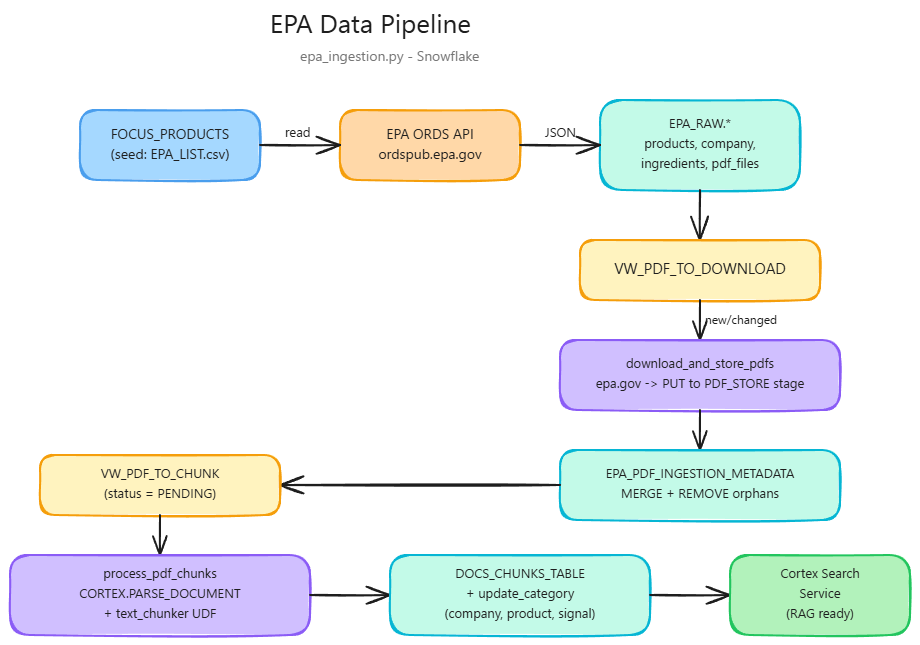
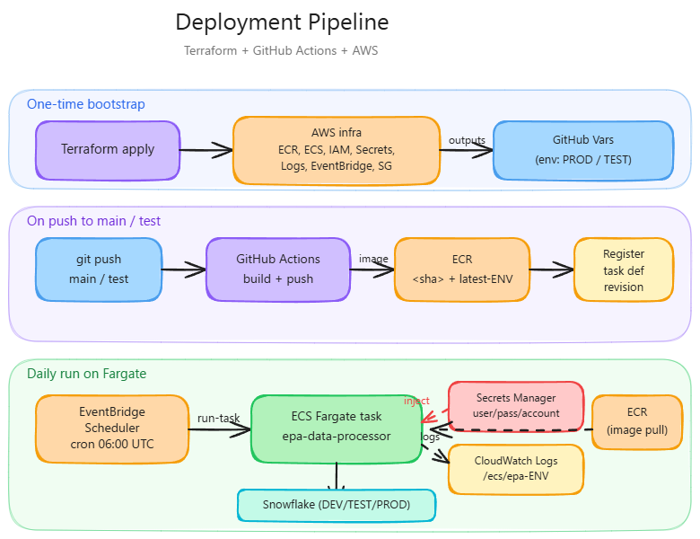

# EPA Data Pipeline

A data ingestion and processing pipeline that pulls EPA pesticide product data and labels, lands them in Snowflake, chunks the PDF labels with Snowflake Cortex, and exposes the chunks through a Cortex Search Service for RAG.

## What it does

1. Reads a list of focus EPA registration numbers from Snowflake (sourced from `EPA_LIST.csv`).
2. Calls the EPA ORDS API (`https://ordspub.epa.gov/ords/pesticides/cswu/ppls/<eparegno>`) for each one and lands the normalized product, company, ingredient, site, pest, type, formulation, transfer-history, and PDF-file metadata in Snowflake.
3. Downloads the latest label PDF for each product, uploads it to a Snowflake stage, and tracks ingestion metadata.
4. Parses each new PDF with `SNOWFLAKE.CORTEX.PARSE_DOCUMENT` and chunks it via a Python UDF (`text_chunker`, LangChain `RecursiveCharacterTextSplitter`, 1512 chars / 256 overlap).
5. Enriches the chunk table with company name, product name, signal word, and EPA type array.
6. (Re)creates a Cortex Search Service over the enriched chunk table for semantic retrieval.

## Repo layout

| Path | Purpose |
|------|---------|
| [epa_ingestion.py](epa_ingestion.py) | Main pipeline (`EPADataProcessor`). Entry point. |
| [config.yaml](config.yaml) | Database/schema/table/UDF/stage names. Overridable defaults. |
| [Dockerfile](Dockerfile) | Container build. `ENVIRONMENT` build arg selects DEV/TEST/PROD. |
| [requirements.txt](requirements.txt) | Python dependencies. |
| [EPA_LIST.csv](EPA_LIST.csv) | Sample focus products (EPA registration numbers) loaded into `{ENV}_DP_APP.MODELED.FOCUS_PRODUCTS` to drive a run. |
| [.github/workflows/main.yml](.github/workflows/main.yml) | CI/CD: build image, push to ECR, register a new ECS task definition revision on push to `main`/`test`. |
| [.aws/epa-task.template.json](.aws/epa-task.template.json) | Parameterized Fargate task definition rendered by the workflow. |
| [terraform/](terraform/) | IaC: ECR, Fargate cluster, IAM, Secrets Manager, log group, EventBridge daily schedule. |
| [pdf_ingestion.py](pdf_ingestion.py) | Legacy standalone PDF downloader, superseded by `epa_ingestion.py`. |

## Pipeline flow



## Snowflake objects created

All names are prefixed by `ENVIRONMENT` (`DEV`, `TEST`, or `PROD`):

- `{ENV}_SRC_INGEST.EPA_RAW.*` — raw API tables (`EPA_PRODUCTS`, `EPA_COMPANY_INFO`, `EPA_ACTIVE_INGREDIENTS`, `EPA_SITES`, `EPA_PESTS`, `EPA_TYPES`, `EPA_TRANSFER_HISTORY`, `EPA_PDF_FILES`, `EPA_ALT_BRAND_NAMES`, `EPA_FORMULATIONS`, `EPA_PDF_INGESTION_METADATA`), the `PDF_STORE` stage with subfolder `EPA_LABEL_PDF`, and the views `VW_PDF_TO_DOWNLOAD` / `VW_PDF_TO_CHUNK`.
- `{ENV}_SRC_INGEST.EPA_PROCESSED.*` — `DOCS_CHUNKS_TABLE`, the `text_chunker` UDF, and the `CC_SEARCH_SERVICE_CS_{ENV}_SRC_INGEST` Cortex Search Service.
- `{ENV}_DP_APP.MODELED.FOCUS_PRODUCTS` — input table with the EPA registration numbers to process. **The pipeline reads from here, not from `EPA_LIST.csv` directly.**

## Prerequisites

- Snowflake account with Cortex enabled (the pipeline calls `SNOWFLAKE.CORTEX.PARSE_DOCUMENT` and creates a `CORTEX SEARCH SERVICE`).
- A user/role that can create databases, schemas, tables, views, stages, UDFs, and Cortex Search Services in `{ENV}_SRC_INGEST` and read from `{ENV}_DP_APP.MODELED`.
- The two databases (`{ENV}_SRC_INGEST`, `{ENV}_DP_APP`) and the `MODELED` schema must already exist.
- Python 3.10 (matches the Docker base image).

## How to run — get data into Snowflake

### 1. Seed the focus products table

The pipeline reads its work list from `{ENV}_DP_APP.MODELED.FOCUS_PRODUCTS`. Load `EPA_LIST.csv` (a sample list of pesticide registration numbers) into that table once before your first run. In a Snowsight worksheet:

```sql
USE DATABASE DEV_DP_APP;          -- or TEST_DP_APP / PROD_DP_APP
USE SCHEMA MODELED;

CREATE TABLE IF NOT EXISTS FOCUS_PRODUCTS (EPAREGNO STRING);

-- Upload EPA_LIST.csv via Snowsight (Data > Add Data > Load files into a table)
-- targeting FOCUS_PRODUCTS, header row = 1, column EPA -> EPAREGNO.
```

To run against a different list, replace the rows in `FOCUS_PRODUCTS`.

### 2. Configure credentials

Create a `.env` file in the repo root (git-ignored):

```env
user=<snowflake_user>
password=<snowflake_password>
account=<snowflake_account>     # e.g. abcd-xy12345
ENVIRONMENT=DEV                 # DEV | TEST | PROD (defaults to DEV)
```

The variable names are intentionally lowercase — `epa_ingestion.py` reads them as `os.getenv('user')`, `os.getenv('password')`, `os.getenv('account')`.

### 3. Install and run locally

```bash
# Windows
python -m venv env
.\env\Scripts\activate
pip install -r requirements.txt
python epa_ingestion.py
```

```bash
# Linux / macOS
python3 -m venv env
source env/bin/activate
pip install -r requirements.txt
python epa_ingestion.py
```

On the first run the script creates all Snowflake tables, the stage, and the UDF; loads product data from the EPA API; downloads PDFs; chunks them; and creates the Cortex Search Service. Subsequent runs are incremental — the views `VW_PDF_TO_DOWNLOAD` and `VW_PDF_TO_CHUNK` only surface PDFs that are new or changed since the last run.

### 4. Run via Docker (optional)

```bash
docker build \
  --build-arg ENVIRONMENT=DEV \
  -t epa-data-processor .

docker run --env-file .env epa-data-processor
```

### 5. Verify

After a successful run, in Snowsight:

```sql
SELECT COUNT(*) FROM DEV_SRC_INGEST.EPA_RAW.EPA_PRODUCTS;
SELECT COUNT(*) FROM DEV_SRC_INGEST.EPA_RAW.EPA_PDF_INGESTION_METADATA WHERE PROCESSING_STATUS = 'CHUNKED';
SELECT COUNT(*) FROM DEV_SRC_INGEST.EPA_PROCESSED.DOCS_CHUNKS_TABLE;
SHOW CORTEX SEARCH SERVICES IN SCHEMA DEV_SRC_INGEST.EPA_PROCESSED;
```

## Configuration

[config.yaml](config.yaml) controls warehouse, database/schema suffixes, table/view/UDF/stage names, and the Cortex Search service prefix. Environment prefix is applied to database names automatically (`SRC_INGEST` → `DEV_SRC_INGEST`). Defaults baked into `DatabaseConfig` match the YAML, so the file is optional.

## CI/CD and AWS deployment

The pipeline ships with a complete production deployment path: Terraform provisions the AWS infrastructure once, then GitHub Actions builds and registers a new ECS task definition revision on every push to `main` (PROD) or `test` (TEST). EventBridge Scheduler runs the task daily on Fargate, with Snowflake credentials injected from AWS Secrets Manager.



### Architecture

- **Compute:** ECS on Fargate (no EC2 to manage).
- **Trigger:** EventBridge Scheduler — `cron(0 6 * * ? *)` (06:00 UTC daily) by default. EventBridge always picks up the latest registered task definition revision.
- **Secrets:** Snowflake `user` / `password` / `account` live in AWS Secrets Manager and are injected as env vars by the task definition's `secrets` block.
- **Image:** `epa-data-processor` ECR repository, tagged with both the commit SHA and `latest-{ENVIRONMENT}`.

### One-time AWS setup (per AWS account)

Requires Terraform ≥ 1.5 and AWS credentials with admin-equivalent permissions for the initial bootstrap.

```bash
cd terraform
cp terraform.tfvars.example terraform.tfvars   # then edit with your values
terraform init
terraform apply
```

This provisions the ECR repo, Fargate cluster, IAM roles (execution + task + scheduler), CloudWatch log group, Secrets Manager secret, security group, and the daily EventBridge schedule.

When `apply` finishes, copy the outputs into your GitHub repository — `Settings → Secrets and variables → Actions`. Create a GitHub Environment named `PROD` (and `TEST` if you also use the `test` branch) and set these as **Variables** on the environment:

| GitHub Variable | Source (Terraform output) |
|-----------------|---------------------------|
| `AWS_REGION` | `aws_region` |
| `AWS_ACCOUNT_ID` | `aws_account_id` |
| `ECR_REPOSITORY` | `ecr_repository` |
| `ECS_CLUSTER` | `ecs_cluster` |
| `TASK_ROLE_ARN` | `task_role_arn` |
| `EXECUTION_ROLE_ARN` | `execution_role_arn` |
| `LOG_GROUP` | `log_group` |
| `SECRETS_ARN` | `secrets_arn` |

And these as **Secrets** on the environment (or repo-wide):

- `AWS_ACCESS_KEY_ID`
- `AWS_SECRET_ACCESS_KEY`

### Routine deploys

Push or merge to `main` (PROD) or `test` (TEST). The workflow:

1. Builds and pushes the image to ECR (`<sha>` and `latest-{ENVIRONMENT}` tags).
2. Renders [.aws/epa-task.template.json](.aws/epa-task.template.json) with the GitHub Variables.
3. Registers a new task definition revision (`epa-task-PROD` or `epa-task-TEST`).

EventBridge automatically picks up the latest revision on the next firing — no further action needed.

### Trigger an ad-hoc run

```bash
aws ecs run-task \
  --cluster epa-cluster \
  --task-definition epa-task-PROD \
  --launch-type FARGATE \
  --network-configuration 'awsvpcConfiguration={subnets=[<subnet-id>],securityGroups=[<sg-id>],assignPublicIp=ENABLED}'
```

Logs stream to the CloudWatch log group `/ecs/epa-prod` (or `/ecs/epa-test`).

### Rotating Snowflake credentials

```bash
aws secretsmanager put-secret-value \
  --secret-id epa-prod/snowflake \
  --secret-string '{"user":"...","password":"...","account":"..."}'
```

Terraform ignores changes to the secret value, so out-of-band rotations stick.

## Notes

- The `CustomAdapter` disables SSL verification because `ordspub.epa.gov` uses legacy SSL. This is scoped to the EPA API session only.
- PDF re-chunking is keyed on `EPAREGNO`, so renamed files do not leave orphan chunks behind. Orphan stage files from prior runs are also removed during the metadata MERGE.
- The warehouse is read from `config.yaml` (`COMPUTE_WH` by default).
